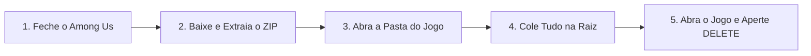

<div align="center">

```text
   ___  _       __                  _ _          
  / _ \| | ___ / _|_ __ ___   __ _ (_) | _____   
 | | | | |/ _ \ |_| '_ ` _ \ / _` || | |/ / _ \  
 | |_| | | (_) |  _| | | | | | (_| || |   <  __/  
  \___/|_|\___/|_| |_| |_| |_|\__,_|/ |_|\_\___|  
                                  |__/            
             A M O N G   U S   M E N U
```

# 🛸 Olofmaike Among Us (`OlofmaikesMenu`)

**Mod Menu completo para Among Us (Windows) com suporte total a partidas Online (Salas Públicas e Privadas), Multijogador Local e Treino Offline.**

<p align="center">
  
  
  
  
  
</p>

<p align="center">
  <a href="https://www.transfernow.net/dl/20261127iq3h5W85">
    
  </a>
</p>

<p align="center">
  <a href="#-segurança-e-verificação">🛡️ Segurança</a> •
  <a href="#-guia-visual-de-instalação">🚀 Instalação</a> •
  <a href="#-manual-interativo-de-funções">✨ Todas as Funções</a> •
  <a href="#-solução-de-problemas-faq">🛠️ FAQ & Suporte</a> •
  <a href="#-créditos-e-arquitetura">📜 Créditos</a>
</p>

</div>

---

## 🎯 Por que escolher o Olofmaike Among Us?

O **Olofmaike Among Us (`OlofmaikesMenu v3.3.1`)** transforma completamente sua experiência no Windows com uma interface rápida, organizada em **11 abas temáticas** e projetada para ser **100% Plug & Play**[cite: 1].

> ⌨️ **Atalho Mestre:** Aperte **`Delete`** a qualquer momento (no menu inicial, lobby ou partida) para abrir/fechar o menu[cite: 1].

| ⚡ Instalação Direta | 🌐 Online & Offline | 🛡️ Verificado & Seguro | 🎮 Zero Limitações |
| :--- | :--- | :--- | :--- |
| Sem instaladores complexos. Extraia e jogue os arquivos na pasta do jogo. | Funciona em **Salas Públicas**, **Salas Privadas**, **LAN** e **Treino Offline**. | `OlofmaikesMenu.dll` aprovado pela equipe da Microsoft e livre de vírus. | Controle total de visão, papéis, portas, sabotagens, chat e host. |

---

## 🛡️ Segurança e Verificação

> ✅ **Status Oficial:** **Verificado e aprovado pela equipe de segurança da Microsoft**

* **Livre de Vírus e Malwares:** O arquivo principal `OlofmaikesMenu.dll` passou pela análise da Microsoft, sendo confirmado como seguro e **não sendo bloqueado nativamente pelo Windows**.
* **E se meu antivírus acusar "Falso Positivo"?**  
  Como todo mod menu baseado em `BepInEx`, a `.dll` precisa se conectar à memória do *Among Us* em tempo real para liberar os recursos. Antivírus de terceiros podem sinalizar esse comportamento como **falso positivo**. Se isso acontecer, basta restaurar o arquivo e adicionar a pasta do *Among Us* às exceções do seu antivírus.

---

## 🎮 Matriz de Compatibilidade

| Modo / Ambiente | Status | Como funciona na prática |
| :--- | :---: | :--- |
| **Build do Jogo** | `2026.9.29` | Verificação automática na inicialização para evitar fechamentos inesperados[cite: 1]. |
| **Lojas de PC** | `Steam` & `Epic` | Suporte total para Windows 10 e Windows 11 (64-bit). |
| **Online — Sala Privada** | 🟢 **100% Ativo** | Jogue com amigos com acesso completo aos comandos de **Host-Only** e **Force Role**. |
| **Online — Sala Pública** | 🟢 **100% Ativo** | ESP, Radar, Revelar Votos, Movimentação e Spoofing de Privacidade operam perfeitamente. |
| **Multijogador Local (LAN)** | 🟢 **100% Ativo** | Compatível com partidas em rede local. |
| **Treino Offline (Freeplay)** | 🟢 **100% Ativo** | Teste papéis, simule animações, complete tarefas e explore mapas livremente. |

---

## 🚀 Guia Visual de Instalação

Não precisa configurar nada. Siga os **5 passos rápidos** abaixo:



### 1️⃣ Baixe e extraia o pacote
* Faça o download oficial: **[Baixar Olofmaike Among Us (TransferNow)](https://www.transfernow.net/dl/20261127iq3h5W85)**
* Clique com o botão direito no `.zip` e escolha **Extrair tudo...** (WinRAR, 7-Zip ou extrator do Windows).

### 2️⃣ Encontre a pasta raiz do Among Us
<details>
<summary><b>🔵 Clique para ver como achar na STEAM</b></summary>

1. Abra sua **Biblioteca** na Steam.
2. Clique com o botão direito em **Among Us**.
3. Vá em **Gerenciar** → **Explorar arquivos locais**.
</details>

<details>
<summary><b>⚫ Clique para ver como achar na EPIC GAMES</b></summary>

1. Abra sua **Biblioteca** no Epic Games Launcher.
2. Clique nos **três pontos (`...`)** abaixo de **Among Us**.
3. Selecione **Gerenciar** → clique no ícone de **pasta com lupa** ao lado de *Instalação*.
</details>

### 3️⃣ Jogue os arquivos na pasta
* Selecione **todos** os arquivos extraídos (`Ctrl + A`), copie (`Ctrl + C`) e cole (`Ctrl + V`) diretamente dentro da pasta onde está o **`Among Us.exe`**.
* Se o Windows pedir para substituir arquivos, confirme em **Substituir os arquivos no destino**.

### 4️⃣ Estrutura final esperada
```text
📁 Among Us/
 ├── 📁 Among Us_Data/        (Pasta original do jogo)
 ├── 📁 BepInEx/              (Plugins, configurações e OlofmaikesMenu.dll)
 ├── 📁 dotnet/               (Bibliotecas auxiliares de execução)
 ├── 📄 Among Us.exe          (Executável principal)
 ├── 📄 winhttp.dll           (Injetor automático)
 └── 📄 doorstop_config.ini   (Configuração de boot do mod)
```

> 💡 **Dica Pro:** Quer manter o jogo original intacto? Copie a pasta inteira do `Among Us` para `C:\Jogos\Among Us Mod` e cole os arquivos do mod apenas nessa cópia!

---

## ✨ Manual Interativo de Funcionalidades

Clique nas categorias abaixo para explorar **cada função detalhada** presente no `OlofmaikesMenu v3.3.1`[cite: 1]:

<details open>
<summary><b>👁️ 1. ESP, Radar & Visão (ESPTab) — <i>Clique para expandir/recolher</i></b></summary>

* **See Player Info:** Exibe informações detalhadas acima dos jogadores (plataforma de origem como Steam, Epic, Mobile, Console e nível da conta).
* **See Roles:** Revela em tempo real o papel verdadeiro de todos na partida (*Impostor, Tripulante, Engenheiro, Cientista, Metamorfo, Fantasma, Detetive, Víbora, etc.*).
* **See Ghosts:** Permite enxergar jogadores mortos (fantasmas) mesmo enquanto você ainda está vivo.
* **See Lobby Info:** Mostra dados técnicos avançados sobre as salas na tela de busca online.
* **No Shadows (Fullbright):** Remove completamente a névoa de guerra e sombras do mapa, permitindo ver através de paredes mesmo com luzes sabotadas.
* **Task Arrows:** Cria setas indicativas na tela apontando para o local exato de cada tarefa sua.
* **Reveal Votes:** Mostra exatamente em quem cada jogador votou durante as reuniões — funciona até mesmo quando a opção **Votos Anônimos** está ativada.
* **Nametags Customizadas:** Aprimora a exibição dos nomes dos jogadores no mapa, nas reuniões e no chat.
* **Tracers (Linhas de Rastreamento):**
  * Conecta linhas do seu personagem até **Tripulantes**, **Impostores**, **Fantasmas** e **Corpos Mortos**.
  * **Color-based:** A linha assume a cor do traje do jogador rastreado.
  * **Distance-based:** A linha muda de cor dinamicamente conforme a distância até o alvo.
* **Minimap (Radar Ao Vivo):**
  * Exibe ícones no minimapa mostrando a posição em tempo real de **Tripulantes**, **Impostores** e **Fantasmas**, com suporte a cores individuais.
* **Câmera Avançada:**
  * **Zoom Out:** Use o scroll do mouse para afastar a câmera e visualizar o mapa inteiro.
  * **Freecam:** Desprende a câmera do seu personagem para explorar o mapa livremente sem mover seu boneco.
  * **Spectate:** Abre uma janela de seleção para assistir a partida pela visão de qualquer jogador[cite: 1].
</details>

<details>
<summary><b>🎭 2. Papéis & Habilidades (RolesTab & RolesUI)</b></summary>

* **Force Role (Exclusivo de Host):** Menu dedicado para escolher exatamente qual papel cada jogador receberá no início da próxima partida (*Crewmate, Impostor, Engineer, Scientist, Tracker, Noisemaker, Guardian Angel, Shapeshifter, Phantom, Viper, Detective, Judge, Influencer*).
* **Set Fake Role:** Altera seu papel visualmente no cliente para testar interfaces e habilidades.
* **Set Fake Alive:** Alterna localmente seu estado entre **Vivo** e **Morto**.
* **Impostor & Metamorfo (Shapeshifter):**
  * **Kill Reach:** Aumenta o alcance máximo do botão de eliminação.
  * **No Ss Animation:** Remove a animação de casulo/transformação do Metamorfo, tornando a troca instantânea.
  * **Endless Ss Duration:** Faz a transformação durar infinitamente até você decidir reverter.
* **Engenheiro (Engineer):**
  * **Endless Vent Time:** Tempo ilimitado dentro das tubulações de ventilação.
  * **No Vent Cooldown:** Zera o tempo de espera para entrar e sair dos dutos.
* **Rastreador (Tracker):**
  * **Endless Tracking:** O rastreamento aplicado em um alvo nunca expira.
  * **No Track Delay / No Track Cooldown / Track Reach:** Remove atrasos no mapa, zera o cooldown e aumenta o alcance de rastreio.
* **Cientista (Scientist):**
  * **Endless Battery:** Bateria infinita no painel portátil de Sinais Vitais.
  * **No Vitals Cooldown:** Zera a recarga para abrir o painel de Sinais Vitais.
* **Detetive (Detective):**
  * **Interrogate Reach:** Aumenta o alcance da habilidade de interrogatório[cite: 1].
</details>

<details>
<summary><b>👑 3. Comandos Exclusivos de Host (HostOnlyTab & ProtectUI)</b></summary>

> *Disponível sempre que você for o criador/anfitrião (Host) da sala.*

* **Murder (Eliminação Direta):**
  * **Kill Player:** Lista rápida com todos os jogadores vivos para eliminar qualquer alvo à distância com um clique.
  * **Telekill Player:** Teleporta até o alvo escolhido, realiza a eliminação e retorna.
  * **Kill All Crewmates / Kill All Impostors / Kill Everyone:** Elimina instantaneamente todos os tripulantes, todos os impostores ou toda a sala.
  * **Kill Anyone:** Permite eliminar qualquer alvo, inclusive outros impostores.
  * **Kill While Vanished:** Permite atacar mesmo estando invisível com o papel *Phantom*.
  * **No Kill Cooldown:** Zera completamente o tempo de recarga entre eliminações.
* **Controle de Partida & Reuniões:**
  * **Force Start Game:** Inicia a partida imediatamente no lobby, ignorando contagens ou mínimos.
  * **No Game End:** Impede que a partida encerre automaticamente por vitórias/derrotas comuns.
  * **Skip Meeting:** Encerra a reunião atual na hora sem ejetar ninguém.
  * **Vote Immune:** Impede que você seja ejetado mesmo recebendo a maioria dos votos.
  * **Eject Player:** Menu durante a reunião para ejetar qualquer jogador específico imediatamente.
* **Protect Menu (Escudo de Anjo da Guarda):**
  * Painel que mostra quem está protegido ou desprotegido. Permite aplicar escudo em jogadores específicos (**Protect**), renovar continuamente (**Keep Protected**) ou proteger toda a sala (**Protect Everyone / Keep Everyone Protected**)[cite: 1].
</details>

<details>
<summary><b>🏃 4. Movimentação & Teleporte (MovementTab)</b></summary>

* **NoClip:** Desativa colisões físicas, permitindo atravessar paredes, portas trancadas e limites do mapa livremente.
* **Invert Controls:** Inverte os comandos direcionais do personagem.
* **Speed & Ghost Speed:** Sliders para aumentar ou diminuir livremente sua velocidade vivo ou como fantasma.
* **Teleport:**
  * **Teleport to Cursor:** Teleporta seu personagem instantaneamente para a posição exata do cursor do mouse.
  * **Teleport to Player:** Menu com todos os jogadores da sala para teleportar diretamente até qualquer um deles[cite: 1].
</details>

<details>
<summary><b>🚢 5. Nave, Sabotagens & Portas (ShipTab & DoorsUI)</b></summary>

* **Sabotagens Instantâneas:**
  * Aciona diretamente **Reator (Reactor)**, **Oxigênio (Oxygen)**, **Luzes (Lights)**, **Comunicações (Comms)**, além de **Mushroom Mixup** e **Trigger Spores** (mapa *The Fungle*).
  * **Open Sabotage Map:** Abre o mapa de sabotagens a qualquer momento, mesmo sendo Tripulante.
  * **Unfixable Lights:** Trava os interruptores da elétrica impedindo que consertem as luzes.
* **Gerenciador de Portas (`DoorsUI`):**
  * Painel separado por salas com status em tempo real (**Open** em verde, **Closed** em vermelho, **Mixed** em amarelo).
  * Ações por sala ou globais: **Close**, **Open**, **Spam Close**, **Spam Open**, **Close All**, **Open All**, **Spam Close All** e **Spam Open All**.
  * **Auto-Open Doors On Use:** Abre portas trancadas automaticamente ao interagir com elas.
* **Tubulações (Vents) & Reuniões:**
  * **Use Vent:** Permite entrar em dutos de ventilação com qualquer papel.
  * **Walk In Vents:** Permite andar livremente pelo mapa enquanto está escondido dentro da tubulação.
  * **Unlock Vents / Kick All From Vents:** Destranca dutos bloqueados e expulsa todos os jogadores escondidos nas tubulações.
  * **Call Meeting / Close Meeting:** Inicia uma reunião de emergência de qualquer lugar ou encerra uma reunião em andamento.
  * **Auto-Report Dead Bodies:** Reporta corpos automaticamente ao entrar no raio de alcance[cite: 1].
</details>

<details>
<summary><b>✅ 6. Tarefas (TasksTab & TasksUI)</b></summary>

* **Complete My Tasks:** Conclui todas as suas tarefas pendentes de uma só vez.
* **Tasks Menu (`TasksUI`):** Abre uma lista detalhada das suas tarefas atuais com acompanhamento de etapas e opção de concluir cada uma individualmente[cite: 1].
</details>

<details>
<summary><b>🎬 7. Animações Visuais (AnimationsTab)</b></summary>

Força a reprodução das animações visuais para todos os jogadores verem (ou apenas na sua tela marcando **Client-Sided**):
* **Shields** (Luzes dos Escudos)
* **Asteroids** (Disparo dos canhões de Asteroides)
* **Empty Garbage** (Despejar o lixo)
* **Medbay Scan** (Scanner verde da Enfermaria)
* **Cams In Use** (Luz vermelha piscando nas câmeras)
* **Moonwalk** (Andar de costas enquanto olha para a frente)[cite: 1]
</details>

<details>
<summary><b>💬 8. Chat & Caixa de Texto (ChatTab)</b></summary>

* **Enable Chat:** Libera o chat durante a partida, mesmo fora das reuniões.
* **Bypass URL Block:** Permite enviar links (`http/https`) e e-mails sem serem bloqueados pelo filtro.
* **Lower Rate Limits:** Reduz o bloqueio anti-spam para enviar mensagens mais rápido.
* **Unlock Extra Characters:** Libera símbolos e caracteres especiais normalmente bloqueados.
* **Allow Longer Messages:** Aumenta o limite máximo de caracteres por mensagem.
* **Unlock Clipboard:** Habilita os atalhos **`Ctrl + C`** e **`Ctrl + V`** dentro do chat[cite: 1].
</details>

<details>
<summary><b>🛡️ 9. Passivo, Privacidade & Spoofing (PassiveTab & Configs)</b></summary>

* **Free Cosmetics:** Libera gratuitamente todos os itens cosméticos (chapéus, trajes, visores, pets e placas).
* **Avoid Penalties:** Evita banimento temporário de matchmaking ao abandonar partidas.
* **Unlock Extra Features:** Desbloqueia chat livre, lista de amigos e nome customizado.
* **Copy Lobby Code on Disconnect:** Copia automaticamente o código da sala para a área de transferência caso você desconecte.
* **Spoofing & Privacidade (Configurável via BepInEx):**
  * **Spoof Platform:** Exibe outra plataforma (*Steam, Epic Games, Android, iOS, Nintendo Switch, PlayStation, Xbox, etc.*).
  * **Spoof Level:** Personaliza o nível exibido no perfil (entre `1` e `100001`).
  * **Spoof Date to April 1st:** Ativa o modo visual especial de 1º de Abril.
  * **Hide DeviceId:** Mascara o identificador único de hardware do PC.
  * **No Telemetry:** Bloqueia o envio de telemetria para os servidores da Unity/Innersloth[cite: 1].
</details>

<details>
<summary><b>⚡ 10. Overload & Teste de Rede (OverloadTab & OverloadUI)</b></summary>

* **Seleção de Alvos:** Jogadores individuais ou grupos inteiros (**All**, **Host**, **Crewmates**, **Impostors**).
* **Ajuste de Potência:** Controles deslizantes de **Strength** (intensidade) e **Cooldown** (intervalo em ms).
* **Auto Adapt:** Ajusta automaticamente a taxa de envio com base no seu **PING** e **FPS**.
* **Kill Switch on Lag:** Parada de segurança automática caso a latência ultrapasse o limite[cite: 1].
</details>

<details>
<summary><b>🖥️ 11. Console, Perfis & Personalização (ConsoleTab, ConsoleUI & ConfigTab)</b></summary>

* **Console de Eventos em Tempo Real (`ConsoleUI`):**
  * Registra histórico completo com horário exato (`HH:mm:ss`) e nome da sala: **Log Deaths**, **Log Shapeshifts**, **Log Vents**, **Log Tasks** e **Log Game State**.
  * Botões rápidos para **Clear Log** e **Copy Log to Clipboard**.
* **Modos Visuais (`ModesTab`):**
  * **RGB Mode:** Efeito arco-íris dinâmico nas bordas e elementos do menu.
  * **Stealth Mode:** Oculta textos e marcas visuais do mod na tela para gravações limpas.
  * **Panic Mode (`PanicCleaner`):** Botão de emergência que desativa e limpa instantaneamente todos os recursos ativos com um clique.
* **Gerenciamento de Perfis e Atalhos (`Keybinds`):**
  * **Save to Profile / Load from Profile:** Salva todas as suas funções ativas e teclas de atalho personalizadas para carregar automaticamente ao iniciar o jogo.
  * **Open Config / Reload Config:** Abre o arquivo de configuração no Bloco de Notas e recarrega alterações sem reiniciar o jogo[cite: 1].
</details>

---

## 🧹 Como Desinstalar e Restaurar o Jogo Limpo

1. Feche o **Among Us**.
2. Abra a pasta raiz de instalação do jogo.
3. Remova os arquivos adicionados pelo mod (`BepInEx`, `dotnet`, `winhttp.dll`, `doorstop_config.ini` e `.doorstop_version`).
4. Valide os arquivos pela loja:
   * **Steam:** Botão direito em *Among Us* → **Propriedades** → **Arquivos instalados** → **Verificar integridade dos arquivos**.
   * **Epic Games:** Três pontos (`...`) em *Among Us* → **Gerenciar** → **Verificar**.

---

## 🛠️ Solução de Problemas (FAQ)

| Problema / Sintoma | Causa | Como Resolver |
| :--- | :--- | :--- |
| **Aviso de versão incompatível no Menu Principal** | A versão do seu *Among Us* difere da build suportada (`2026.9.29`)[cite: 1]. | Atualize seu jogo na loja ou baixe a versão correspondente do mod. |
| **O jogo abre normal, mas apertar `Delete` não abre o menu** | Os arquivos foram colados dentro de uma subpasta em vez da raiz. | Mova todos os arquivos para a mesma pasta onde está o `Among Us.exe`. |
| **Antivírus acusou ameaça ou apagou a DLL** | Falso positivo comum em mods de injeção. O `OlofmaikesMenu.dll` é aprovado pela Microsoft e livre de vírus. | Adicione a pasta do *Among Us* às exceções do seu antivírus e extraia novamente. |
| **Funções de "Host-Only" ou "Force Role" não funcionam** | Você entrou na sala de outra pessoa e não é o anfitrião (*Host*)[cite: 1]. | Crie sua própria sala privada/pública para ser o Host e liberar esses comandos. |
| **O jogo fecha sozinho logo ao abrir** | Algum arquivo ficou faltando ou foi bloqueado durante a extração. | Extraia o `.zip` novamente e substitua todos os arquivos na pasta raiz do jogo. |

---

## 📜 Créditos e Arquitetura

* **Autoria & Personalização Visual:** **Olofmaike** — Responsável pela criação, personalização visual, interface e distribuição do pacote **Olofmaike Among Us (`OlofmaikesMenu`)**[cite: 1].
* **Versão do Mod:** `v3.3.1` (`OlofmaikesMenu.dll`)[cite: 1]
* **Versão Suportada do Jogo:** Among Us `2026.9.29` (Windows 64-bit — Steam & Epic Games)[cite: 1]
* **Arquitetura & Tecnologias:**
  * **BepInEx Unity IL2CPP:** Framework de carregamento de plugins para Unity IL2CPP[cite: 1].
  * **0Harmony (HarmonyLib):** Biblioteca para aplicação de patches em tempo real[cite: 1].
  * **.NET 6.0 / C#:** Linguagem e runtime utilizados no desenvolvimento do menu[cite: 1].
* **Segurança & Distribuição:**
  * Arquivo `OlofmaikesMenu.dll` verificado e aprovado pela equipe de segurança da Microsoft.
  * Hospedagem oficial via TransferNow.

---

<div align="center">

**🛸 Olofmaike Among Us (`OlofmaikesMenu v3.3.1`)**  
Desenvolvido por **Olofmaike** • Todos os direitos reservados à comunidade de modding[cite: 1].

</div>
